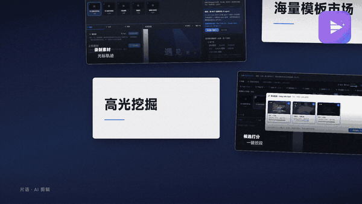

# 片语 · Pianyu

**开源的本地 AI 视频剪辑器。** 用一句话说清需求，AI 自己剪成片——素材和模型都留在你自己的电脑上。

> English: Pianyu is an open-source, local-first AI video editor for Windows. You describe the result in one sentence; a fine-tuned on-device model drives 29 editing tools to produce the cut. Footage and model stay on your machine.



> 上面这支片子和片子里演示的每条剪辑，都是片语自己剪出来的。

---

## 它是什么

不是"给你一堆功能"，而是**替你动手**：

- **对话式剪辑**：说「把这段录屏剪成 30 秒新手教程，每步配说明」，AI 自己看素材、挑镜头、拆段、写文案、设转场、渲染成片
- **真实素材工作流**：镜头扫描（`scan_media`）→ 高光挖掘（`mine_highlights`）→ 裁剪落地（`apply_cut_list`）→ 取景精修
- **63 个内置模板**：宣传片 / 教程 / 混剪 / vlog 四类气质，4:3 / 16:9 / 1:1 / 9:16 四画幅
- **时间线 NLE**：五轨（段 / 镜头 / 字幕 / 音效 / BGM）+ 逐帧预览
- **本地推理**：内置 llama.cpp `llama-server` 运行时，GGUF 权重直读；也可接任意 OpenAI 兼容的云端端点
- **可被外部 agent 驱动**：内置 MCP 服务，Claude Code / Codex / 自写脚本都能调它的编辑工具

导入素材 → 说需求 → 出片。全程不联网也能跑。

## 快速开始

```bash
git clone <this-repo> pianyu && cd pianyu
npm install            # 首次会下载 Remotion 浏览器内核
npm run dev            # 开发模式（热更新）
```

打包：

```bash
npm run dist:nsis      # Windows 安装包 → dist/
npm run package        # 免安装目录版
```

要求：Windows 10/11 x64、Node.js 20+。项目用 Electron 32 + electron-vite + React 18 + Remotion 4。

## 开源边界

**应用本体完全开源（MIT），且不设任何人为限制**——导出无水印、不限分辨率、不限时长，全部功能可用。

以下内容不在此仓库：

| 内容 | 说明 |
|---|---|
| 专有模型权重 | 片语微调的 Qwen3-VL-2B（GGUF ~4.3GB）。**订阅 ¥6/月** 提供下载与更新，见 [MODEL-LICENSE.md](MODEL-LICENSE.md) |
| 模板市场付费包 | `.vttemplate` 扩展包（行业包 / 新形态） |
| 授权与支付后端 | `server/`、下载通道、订阅管理 |

**说清楚**：App 不锁你用什么模型。你可以接自己的 Ollama / llama-server GGUF，也可以填任意 OpenAI 兼容的 API Key——功能不受限，导出也不打水印。订阅买的不是"解锁软件"，而是"省掉自己找模型、调参数、下权重这一步"。这决定了开源不会变成"假开源"：删掉这一层，软件依然完整可用。

## 目录结构

```
src/main/            Electron 主进程（文件、ffmpeg、llama-server 生命周期、MCP 服务）
src/renderer/        渲染进程（时间线 UI、对话面板、模板市场）
src/shared/          共享层（工具注册表、schema、模板注册表、提示词）
src/remotion/        Remotion 渲染（63 个模板的逐帧组件）
resources/           字体 / 配乐 / 音效 / LUT / 示例工程（授权见各目录内说明）
tests/               单元测试（npx tsx tests/unit/*.test.ts）
build/               Windows 打包资源（图标、商店磁贴）
```

## 贡献

- Issue 先行：功能建议请写清"什么场景 + 现在卡在哪"
- 提交前跑 `npm run typecheck`，模板改动请附四个画幅的探针截图
- 模板贡献：新增模板需在 `src/shared/template-registry.ts` 注册，并声明 `textSlots` / `minVideos`

## 第三方资源

- 字体：见 `resources/fonts/FONTS.md`（SIL OFL 1.1 / 小米 MiSans 许可，许可原文在 `resources/fonts/licenses/`）
- 配乐：见 `resources/bgm/ATTRIBUTION.md`（Kevin MacLeod / incompetech，CC BY 4.0，**成品发布需署名**）
- 音效：CC0

## 许可证

**应用本体采用 MIT——完全开源，无任何附加限制。** 见 [LICENSE](LICENSE)。

你可以自由使用、修改、分发、商用、甚至换个名字发布，不需要我们的同意。

唯一不在这份许可里的东西：

- **模型权重**：专有，订阅后下载，见 [MODEL-LICENSE.md](MODEL-LICENSE.md)
- **模板市场付费包**：`.vttemplate` 扩展包
- 第三方字体与配乐：遵循各自许可证（`resources/fonts/FONTS.md`、`resources/bgm/ATTRIBUTION.md`）

这不是"假开源"：删掉模型这一层，你拿到的仍是一个功能完整、无限制的剪辑器。
